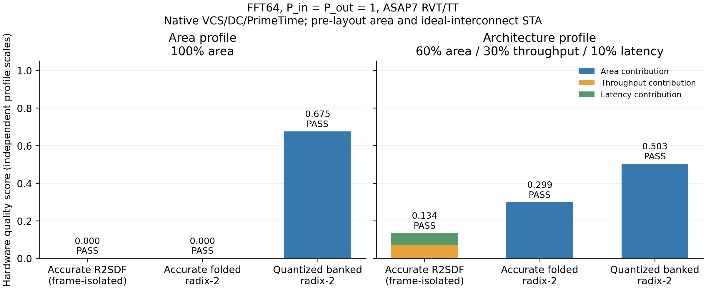

# FFT64 v0.4 双模式：本机 Synopsys 实测

两个模式均在本机 SSH Synopsys Docker 跑通。参考解面积模式得 **0.674934**，架构模式得 **0.502826**，均为 `resolved=true`。两份准确基线的面积模式为 **0 分且通过**：分数只负责排名，规格负责通过判定。故意声明不支持的 319-cycle 间隔则漏帧失败，不进入可行排名。

这次更新评测机制，并未重新优化参考 RTL。除统一 hold 修复流程外，三份电路维持原有实现。不能将评分协议改变解释为新的电路优化收益。

## 实测对照

N=64，输入/输出 P=1，ASAP7 RVT/TT，统一 DC 映射和 PrimeTime ideal-interconnect STA；共同规格为 10ns、逐帧 SQNR≥50dB，首输出≤300 cycles、完成≤364 cycles。

| 设计 | 面积 µm² | 认证周期 ns | 验证 II cycles/frame | 持续吞吐 MFFT/s | 首输出 ns @10ns | 最低 SQNR dB | 面积模式 | 架构模式 | 规格 |
|---|---:|---:|---:|---:|---:|---:|---:|---:|---|
| 准确定点 R2SDF（逐帧隔离） | 3644.52 | 4.363281 | 197 | 1.163377 | 1330 | 70.58 | 0.000000 | 0.134211 | PASS |
| 准确定点复用 radix-2 | 2437.28 | 3.839600 | 320 | 0.813887 | 2560 | 70.58 | 0.000000 | 0.298590 | PASS |
| 数据/系数量化＋banking 参考解 | 1614.78 | 3.820557 | 320 | 0.817944 | 2560 | 55.30 | 0.674934 | 0.502826 | PASS |

面积模式仍以至少 384 cycles/frame 的共同工作负载评价；表中的更短 II 由架构模式额外实测。认证周期是重新约束同一 mapped netlist 后、setup/hold 都通过的端点，失败/通过区间宽度≤0.01ns。吞吐量为 `1e9/(period_ns × II)` FFT/s，复样本吞吐为其 64 倍。首输出评分使用共同 10ns 时钟，频率不通过延迟再次计分。在认证时钟下参考解首输出为 978.0625ns；该数值另行报告，不混入共同目标时钟下的延迟分数。

R2SDF 基线使用逐帧隔离控制，实测 II=197；不能将其结果理解为所有 R2SDF 实现的吞吐极限。两份准确基线都扫描了 64–384 的全部 321 个整数 II，并保留失败点。小样本通过后，所选间隔在完整 376 帧、16 帧混合间隔尾部，以及三个 mapped 时刻零初态下再次验证；候选按声明的 II=320 完成相同验证。这里是经验验证的可达服务间隔，未证明形式化全输入最小 II。

## 冻结的评分规则及校准

默认面积模式：`S=V*clip((A_ref-A)/(A_ref-A_target),0,1)`。本平台 `A_ref=2437.28028µm²`，`A_target=1218.64014µm²`，目标是最佳准确面积的 50%。参考解相对该准确基线节省 33.7467%，所以得分为其两倍，而不是旧版的原始面积节省比例。

架构模式：`S=V*(0.6*S_A+0.3*S_T+0.1*S_L)`。各分项 clip 到 [0,1]。其准确基线分量参考向量和目标为：

| 分项 | 0 分参考 | 1 分目标 |
|---|---:|---:|
| Area µm² | 3644.51886 | 1218.64014 |
| Throughput FFT/s | 813886.946 | 2326754.496 |
| First-output latency ns @10ns | 2560.000 | 665.000 |

该向量来自准确基线各分量的既定统计，不冒充某一份真实电路。两个模式使用独立校准，分数不可互相比大小。权重及目标比例在 2026-11-21 12:26:57 UTC 冻结，早于新的 II/频率测量及候选打分；规则 SHA-256 为 `78639b42bf9bb24595d4a23c3f199d26774c0d32c5968397c8a427f1c9f2efb4`，准确基线校准完成后才评测候选。没有根据候选结果调整目标。SQNR 达到门槛即可，不因更高精度加分。



图中是加权分项贡献。准确复用实现相对 R2SDF 的精确面积优化也能在架构模式中获得分数；R2SDF 则得到吞吐和延迟贡献。参考解主要通过面积得分。图和数字不表示某个架构族的全局优劣。

## 验证与反例

- 每份设计、每个模式均通过 376 帧的普通四态 RTL 数值/协议验证和三种 binary 时刻零初态的完整 mapped VCS 对照。架构模式另外通过 392 帧的连续/混合间隔验证（其中尾部 16 帧复用输入，不称为独立随机样本）。复位、长空闲、输出顺序及截止时间保持原有要求。
- 实际将参考解声明间隔改为 319 后，应有 392 帧，实际只输出 200 帧；结果 `resolved=false, score=0`。原因是协议/吞吐失败，见 `diagnostics/invalid_ii_319.json`。
- 新共用流程修复旧准确复用型实现约 −1.17ps 的 hold 违例。`set_fix_hold` 单独未完成修复，采用 DC 的 `compile -incremental_mapping -only_hold_time` 后通过。准确复用面积从旧记录的 2436.05556 增至 2437.28028µm²，额外修复单元计入面积；R2SDF 和参考解本来 hold 已通过，面积不变。该收益/开销属于精确实现流程，不归因于 approximate computing。
- 两个模式对每份设计的 mapped SHA 和面积完全相同，已逐项核对；没有混用综合分母。39 个 STA 扫描点和两组共 642 个整数 II pilot 记录保留。
- 最终 70 项 operator 回归在宿主机、纯评测分支和原生容器 Python 上通过，另有 7 项参考接口回归、13 项环境策略及 5 项缓存回归通过。单元测试含显式合成数据，不能代替上面的真实商业测量。
- 重复运行面积模式复用准确校准与候选，`reused=true`。新的控制器也拒绝将未写完最终结果的 checkpoint 当作完成结果。

## 文件与复现

- [评分定义](../../../fft64_benchmark/SCORING.md)；[完整参数](../../../fft64_benchmark/profiles/policy.json)。
- [面积模式原始汇总](area/RESULTS.md)、[CSV](area/measurements.csv)；[架构模式原始汇总](architecture/RESULTS.md)、[CSV](architecture/measurements.csv)。
- [一致性验证](validation_receipt.json)，逐点 STA、II 成败、逐帧质量、库/工具/RTL 哈希及不可变源码快照见各模式子目录。
- [PDF 图](score_comparison.pdf)；由 `operator/plot_scoring_profiles.py` 从实际汇总生成。

```bash
bash run_synopsys.sh fft64_solution --profile area --origin reference --out /workspace/eval/area
bash run_synopsys.sh fft64_solution --profile architecture --origin reference --out /workspace/eval/architecture
```

本机共享挂载使用 `run_synopsys_docker.sh`，输出例为 `/mnt/mydata/eval/area`。新默认协议按 specification 分目录保存，旧 checkpoint 和 v0.3 结果不删除。所有额外时刻零初始化只在仿真起始设置，运行中不强制修补信号。

原始实验使用独立不可变源码快照。其数值、评分、仿真和物理测量模块与最终版本一致；随后仅完善了完成状态、部分 checkpoint 重试及默认协议命名空间。具体差异保存在 `diagnostics/controller_changes_after_snapshot.patch`，最终控制器另经原生回归。评价附件也绑定原校准的输入种子与规模，避免打包时悄悄更换质量/吞吐协议。所有数据是 pre-layout synthesis / ideal-interconnect STA；未完成 P&R、功耗或真实芯片频率测量，也不声称形式化全输入误差/等价保证。
