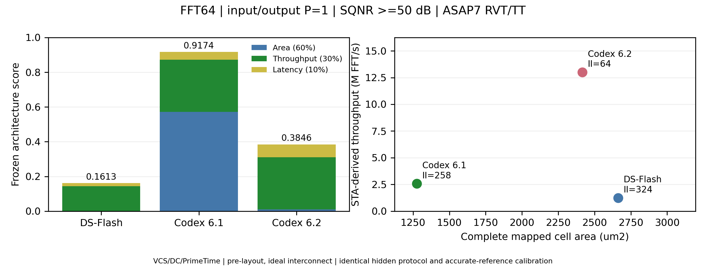
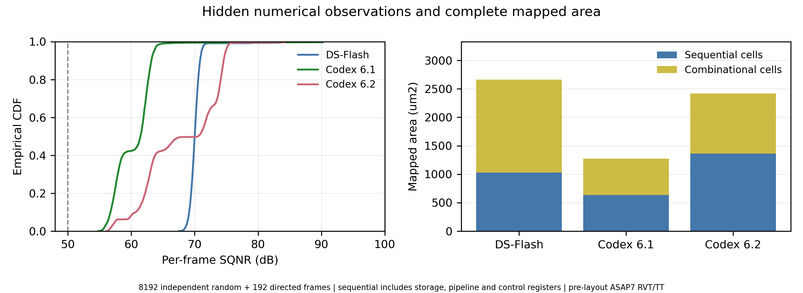

# 三个 Agent 的 FFT64 结果核验与比较

三份最终提交均通过同一私有协议下的数值、连续服务、映射网表及时序检查。冻结评分下，Codex-GPT-6.1-Sol-Max 得分最高；Codex-GPT-6.2-Sol-Max 的实际吞吐率最高、首输出延迟最低；Claude-DS-Flash 保留了最大的 SQNR 余量，但面积、吞吐率和延迟均落后于另外两个提交。

这些是三次具体运行的设计结果，不是对模型普遍能力的统计排名。未修改任何 Agent 的 RTL 或 recipe，也未根据结果改变评分函数、权重或归一化目标。

## 同一口径的最终结果

所有设计都是 N=64，外部输入/输出 P=1；同一 ASAP7 RVT/TT 库，同一 VCS/DC/PrimeTime 测量流程，10 ns 基本时序要求，非零逐帧 SQNR 至少 50 dB，零帧精确为零。数值参考为相同量化输入的 float64 forward FFT。

每个设计重新执行 8192 个独立隐藏随机非零帧及 192 个定向测试。每个设计对 II=64…384 的全部 321 个整数值分别测试 1024 个连续 RTL 帧；最小通过 II 还进行代表性 mapped 确认。包含复位、间隙、长期计数器及三种门级初始状态检查。固定网表的 STA 周期扫描使用通过端点，失败/通过区间不超过 0.01 ns。门级测试是代表性子集，不是全部输入的形式化等价证明。

准确 folded 和准确 block-scheduled R2SDF 的既有完整测量与本轮 Python、工具、库、驱动和输入协议身份一致，因此复用其有效校准。两份准确参考及候选均使用同一冻结标尺；没有重用候选的公开容量结果替代私有重测。

| Agent | 面积 μm² | 认证周期 ns | Fmax MHz | 最小验证 II | 首输出 / 完成 cycles | 最低隐藏 SQNR dB | 有效分数 |
|---|---:|---:|---:|---:|---:|---:|---:|
| Claude-DS-Flash | 2662.25 | 2.468506 | 405.10 | 324 | 259 / 322 | 67.4970 | **0.161277** |
| Codex-GPT-6.1-Sol-Max | 1275.53 | 1.506836 | 663.64 | 258 | 194 / 257 | 54.8091 | **0.917386** |
| Codex-GPT-6.2-Sol-Max | 2415.95 | 1.202148 | 831.84 | 64 | 127 / 190 | 56.0291 | **0.384592** |

| Agent | 认证时钟下 M FFT/s | 固定 10 ns 下 M FFT/s | 认证时钟首输出 ns | FFT/s/μm² | 顺序单元面积 μm² |
|---|---:|---:|---:|---:|---:|
| Claude-DS-Flash | 1.250319 | 0.308642 | 639.34 | 469.65 | 1030.22 |
| Codex-GPT-6.1-Sol-Max | 2.572257 | 0.387597 | 292.33 | 2016.62 | 634.24 |
| Codex-GPT-6.2-Sol-Max | 12.997563 | 1.562500 | 152.67 | 5379.90 | 1364.70 |

这里的能力吞吐率为 `1e9/(认证周期 ns × 验证 II)`。共同 10 ns 时钟下的吞吐另列，避免把 STA 认证能力误写为固定 10 ns 的实际服务率。延迟分项仍使用共同 10 ns 的最大逐帧延迟；认证周期的物理延迟只作额外说明。

所有数值均为 pre-layout cell area / ideal-interconnect STA。没有 post-route、可靠功耗或 energy 测量。

## 设计差异解释

**Claude-DS-Flash：folded radix-4。** 使用 22 位 Q15 数据、12 位 Q10 twiddle、三个三实乘复数乘法器。局部流水预计算 twiddle 和操作数和，最终使用单写端口顺序写回。它实现了正确的 FFT，并做过实际试验和回退；但较宽数据、全地址读 mux 以及三组复数乘法器保留了较高面积，串行 load/compute/output 调度限制 II。每个 radix-4 butterfly 占用多个时隙，减少算法 stages 没有自动转化为更小的帧 II。RTL 文件头仍残留“输出重叠、Q12 twiddle”等旧描述，实际参数与最终 DESIGN_PLAN/测量应优先。

**Codex-GPT-6.1-Sol-Max：面积优先的 folded radix-2。** 使用两组 parity bank、15 位存储、自适应共享 block exponent、10 位 Q9 系数及三实乘旋转；把首级运算融入输入捕获、末级融入输出，再加两级 butterfly 流水。1.5 ns 综合目标引导映射，最终仍由固定流程独立导入和认证。数据宽度缩减和调度优化同时发挥作用；动态缩放控制、舍入和输出增益恢复都包含在完整 mapped 面积中。

**Codex-GPT-6.2-Sol-Max：吞吐优先的 streaming R2²SDF。** 六级 SDF butterfly 配合两个非平凡 rotator，采用 stage-specific 位宽、Q11 系数、round-to-even、三实乘和八分之一波对称。输入重排用 50-word 存储复用，保持连续每周期一个样本、每 64 周期一帧。1.2 ns 综合目标及 `optimize_netlist -area` 对映射做优化。面积更大，但持续服务能力和物理延迟明显更好。

相较 6.1，6.2 面积增加 **89.41%**，认证吞吐率达到 **5.053 倍**，单位面积吞吐达到 **2.668 倍**，首输出物理延迟降低 **47.77%**。两者是不同取舍的非支配点。在本轮 50 dB 质量门槛下，Claude 的 PPA 被另外两个提交支配；额外 SQNR 余量按规则不加分。

## 为什么吞吐最高者不是分数最高者

冻结规则为 `S=0.6 S_A+0.3 S_T+0.1 S_L`，基本规格通过与硬件分数分开。下表列出未经加权的分项：

| Agent | S_A | S_T | S_L | 总分 |
|---|---:|---:|---:|---:|
| Claude-DS-Flash | 0.000000 | 0.479061 | 0.175589 | 0.161277 |
| Codex-GPT-6.1-Sol-Max | 0.953316 | 1.000000 | 0.453961 | 0.917386 |
| Codex-GPT-6.2-Sol-Max | 0.017504 | 1.000000 | 0.740899 | 0.384592 |

面积参考为 2437.28028 μm²、目标为 1218.64014 μm²；吞吐参考为 0.260417 M FFT/s、目标为 2.326754 M FFT/s；延迟参考/目标为 3000/665 ns。这些值来自准确参考与冻结目标比例。

这里有两个必须明确的区间效应：

1. **面积零分区间。** Claude 面积超过参考，面积分为零；6.2 仅略低于参考，面积分很小。6.1 接近面积目标，获得明显优势。
2. **吞吐满分饱和。** 6.1 与 6.2 都超过 2.326754 M FFT/s，吞吐分均为 1；6.2 的额外吞吐不再加分。因此总分无法完整表达二者超过目标后的吞吐差异。

本轮得分说明谁更符合当前冻结的面积权重与目标，不等于谁在全部应用下都更好。若需求超过 6.1 的实际能力，必须选择更高吞吐架构；不能靠较高综合分替代实际吞吐约束。没有在看到结果后改评分标尺。

## 数值质量与公开结果一致性

`analysis/public_vs_hidden.csv` 对照源码身份、面积、周期、II 和延迟。所有三份源码与公开测量的最终 RTL 一致；两个导出网表也与提交 manifest 一致。Claude 的最终 scheduling hint 从公开记录的 320 改为 324，但 RTL 未变，私有评测忽略该 hint、独立测得实际最小 II。

公开数值集与私有数值集不同，因此最低 SQNR 的小幅变化正常，不应该要求相等。三者数值测试中最差帧都来自低幅度复数正负符号输入族（`independent_random_5`），而非大幅度常规随机帧。最终均通过 50 dB 规格；此结果不能外推为 formal worst-case guarantee。

顺序单元面积包含数据存储、流水和控制寄存器，不能全部称为 FFT delay storage。没有通过不可靠的 flatten 后名称推测 multiplier/BU 的独立面积。

## 文档与推理核验发现

以下发现用于解释设计过程，没有另外扣除硬件分数；有效分数完全由冻结规则与最终电路测量决定。

**Claude 的 banking 不可能性论断不成立。** 其文档称不存在适用于三个 radix-4 stages 的固定两位 bank 函数。反例是 `bank(a)=a[1:0] XOR a[3:2] XOR a[5:4]`，行地址可取 `a[3:0]`。对任一 stage，四个 butterfly 地址只改变一个 base-4 digit，因而映射到四个不同 bank。脚本穷举了全部 64 个地址和 48 个 butterfly，验证了唯一分配且无该类冲突。这是地址分配反例，尚未实现或测量新的四 bank FFT，不能宣称具体面积改善。

**Claude 对最终候选的评分推理遗漏 clipping。** 它为了面积权重选择更小但略慢的单写端口候选，并声称在较小参考面积下始终得分更高。然而在本轮参考下，其两个最终候选面积均超过参考、面积分均为零；较小面积在这一段没有回报。这说明 Agent 进行了真实实验，但最后的目标函数推理还可改进。未把未提交候选的公开 PPA 回放当作新的正式隐藏评分。

**6.1 的 legacy effort 选项被工具忽略。** 与其导出网表匹配的真实 DC build log 含 `OPT-1341: -area_high_effort_script option is ignored`。1.5 ns clock target 和具体网表的有效性不受这个描述问题影响；但不能将收益归因于该 effort 开关。6.2 的记录已指出这一限制，并显式调用 `optimize_netlist -area`。

## 交付与适用范围

每份通过核验的设计保存在私有 FFT-Eval 的 `agents/<Agent名称>` 分支；保留提交源文件、recipe、导出网表、私有测量和校准。旧的 `Codex-GPT-6.1-Sol-Max` 分支包含此前结果，保持不变。比较报告位于 `validation/three-agent-comparison` 分支。

公开 FFT-Bench 与测试 Agent 的原始工作目录未被改动。新 Claude-Fable-5.2 环境仅放置相同的公开仓库、独立 Synopsys 挂载和端口配置，没有复制这些私有结果或准确参考。

三次运行没有统一记录实际 Agent 时间、token、总 EDA 次数等执行预算，所以不能据此单独归因模型本身的能力差异，也不能宣称架构全局最优。本轮有效结论是：6.1 的提交在当前评分下最优，6.2 的提交适合更高吞吐需求，而 Claude 的正确实现还有明显的 precision、banking 与目标函数理解方面的优化空间。
