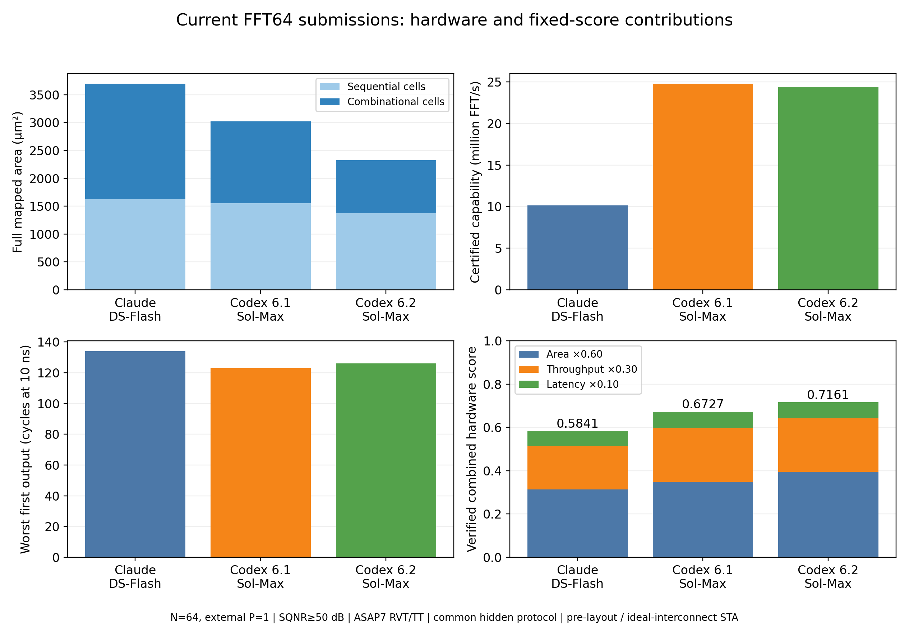

# 本轮 FFT64 Agent 提交核验与比较

三份最终提交已按同一独立隐藏协议完成核验，均满足基本规格。下文比较的是这三次运行实际交付的电路；其他模型尚未完成，总体模型能力结论与最终排名留空。批准的评分规则、权重、归一化目标、RTL 和提交 recipe 均未因结果而修改。

## 实测结果与对话用时

统一条件为 FFT64、外部输入/输出 P=1、同一 ASAP7 RVT/TT 库、VCS/DC/PrimeTime、10 ns 强制时序与逐非零帧 SQNR≥50 dB。三份完整导出网表分别独立导入计面积、做 STA 和 RTL/门级行为检查。准确参考的已有有效校准经过平台/协议指纹匹配后复用；没有用 Agent 的公开结果替代私有候选复测。

每个候选测试 8192 个独立隐藏随机非零帧和 192 个定向帧，II=64…384 的全部 321 个整数值各运行 1024 连续 RTL 帧，最小通过 II 再经代表性门级确认。包含复位、间隙和三个门级初始状态检查。频率采用同一固定网表 STA 扫描的通过端点。质量是有限样本观测，门级覆盖是代表性子集，不是形式化最坏误差证明。

| 本轮提交 | 面积 μm² | 认证周期 ns | 最小验证 II | 认证能力 M FFT/s | 首 / 末输出 cycles | 最低隐藏 SQNR dB | 综合分数 | 用户提供对话用时 |
|---|---:|---:|---:|---:|---:|---:|---:|---|
| Claude-DS-Flash | 3695.72 | 0.764160 | 129 | 10.144 | 134 / 197 | 66.1488 | **0.584148** | 1h55m16s |
| Codex-GPT-6.1-Sol-Max | 3023.22 | 0.630859 | 64 | 24.768 | 123 / 186 | 52.7570 | **0.672667** | 37m33s |
| Codex-GPT-6.2-Sol-Max | 2327.20 | 0.640381 | 64 | 24.400 | 126 / 189 | 59.4169 | **0.716134** | 37m15s |

硬件吞吐为 1e9/(认证周期×验证 II)。延迟分项使用共同 10 ns 下的最大首输出 cycles；认证时钟的物理延迟另存于 CSV，没有再次奖励频率。全部 PPA 为布局前 cell area / ideal-interconnect STA；没有 post-route 或可靠功耗结果。

[矢量 PDF](figures/hardware_and_score.pdf)；[面积–吞吐权衡图](figures/area_throughput.pdf)。

对话用时来自用户提供，按原值存档，既不代替 EDA 运行时间，也不进入硬件分数。日志另存消息起止与平台任务计时：6.1 的 task_complete 为 2253.103 s；6.2 为 2247.314 s，比用户给出的 2235 s 多 12.314 s，两种口径均保留。Claude 的实际任务首条提示至末条答案为 6915.504 s；较早的本地设置和较晚的退出等待不计入该区间。

## 评分差异来自哪些硬件指标

| 本轮提交 | 面积分项 | 吞吐分项 | 延迟分项 | 全部顺序单元面积 μm² | 组合单元面积 μm² |
|---|---:|---:|---:|---:|---:|
| Claude-DS-Flash | 0.522722 | 0.668242 | 0.700422 | 1622.83 | 2072.90 |
| Codex-GPT-6.1-Sol-Max | 0.581084 | 0.831111 | 0.746835 | 1551.98 | 1471.24 |
| Codex-GPT-6.2-Sol-Max | 0.657005 | 0.828377 | 0.734177 | 1370.32 | 956.89 |

顺序面积包含数据存储、流水及控制寄存器，不能全部称为 FFT delay storage。组合面积按总面积减去顺序面积得到，没有根据 flatten 后名称猜测 BU/乘法器归属。

在这三份已测电路中，6.2 的综合分最高且面积最小，6.1 的认证周期略短，二者都支持 II=64。Claude 的 SQNR 余量最大，但在已满足共同 50 dB 门槛的比较中，其面积、吞吐和延迟均落后于另两份提交；更高 SQNR 按规则不加分。

6.2 相对 6.1 的加权变化为：面积 +0.045553，吞吐 -0.000820，延迟 -0.001266，合计 +0.043467。面积减少 23.02%，吞吐减少 1.49%，首输出晚 3 cycles。组合逻辑面积少 514.35 μm²，顺序单元面积少 181.67 μm²，说明面积差异不能只归因于寄存器数量。

## 电路与搜索过程的区别

**Claude-DS-Flash：R2SDF DIF，保留较多数值精度。** 六级反馈延迟为 32/16/8/4/2/1，数据保持 15 位小数并逐级增加保护位，使用 Q10 twiddle 和 22-bit 的输出重排序存储。帧间采用零输入推进与刷新，当前控制和重排序实现使最小服务间隔为 129，而不是理想连续 SDF 的 64。它比较了两个完整 architecture 候选，最终更激进的时序映射增加面积但略提高综合分，选择与完整公开评分一致。

**Codex-GPT-6.1-Sol-Max：R2²SDF DIF，优先压短算术路径。** 两个非平凡复数旋转器各用三个实数乘法，注册系数及乘积，最终以单个 64-word、每分量 19-bit 的交替重排序存储输出自然频点。输入从 Q15 舍入到 Q14，后续逐级变为 Q13/Q12；Q9 系数和 nearest-even 窄化控制数值误差。DC 目标 500 ps，使用 timing-high-effort 和增量 hold 修复。它完成了 11 个 architecture 候选，选择的电路并非面积最小者，而是完整综合分最高者。更窄的最终重排序存储在该批完整映射中反而增加总面积，未被选为最终提交。

**Codex-GPT-6.2-Sol-Max：R2²SDF DIT，将重排序移到输入端。** 输入位交换延迟为 31、14、4，共 49 个 complex word，每分量 15-bit；DIT 后续自然输出频点。它使用给定输入范围的整数位冗余：signed 15-bit Q15 保留原有 15 个小数位，仅把正端点 +0.5 饱和减少一个输入 LSB；6.1 的 signed 15-bit Q14 则通过舍入少保留一个小数位。两者的舍入误差来源不同，不能只用相同的“15-bit”判断精度。6.2 在两个旋转器采用 Q9/Q10 系数、Q15→Q14→Q12 量化和绝对残余系数表示，DC 目标 640 ps 并做 area recovery。它比较了 10 个完整 architecture 候选；更快的 split-product/retiming 实现因面积或延迟代价没有成为最终选择。

从 RTL 看，仅重排序数据存储的声明容量为 6.1 的 64×2×19=2432 bits 与 6.2 的 49×2×15=1470 bits。这能解释一部分结构差异，但其反馈网络顺序、量化位置、系数表示、控制和综合 recipe 也不同，不能把整个面积变化归因于单个因素。6.2 自己的公开对照中，去掉前两级输入交换的输出寄存器保持认证周期与 SQNR，面积减少 17.46684 μm²、首输出提前 2 cycles，是较清楚的局部流水优化证据。其文档给出的解析误差推导另行保留，不作为本次独立完成了 formal guarantee 的证据。

## 记录一致性与适用范围

三份最终 RTL 和导出输入网表均与选择的公开记录身份匹配，所选分数是各自已完成、可行 architecture 公开候选中的最高值。公开与私有最低 SQNR 的差别来自输入样本不同；完整硬件指标的对照见 public_vs_hidden.csv。导出网表哈希与评测器规范化后的网表哈希分别记录，不能把合法导入/命名规范化造成的差异误判成换设计。

聊天记录已按本轮会话导出为可读 JSON，包含用户/助手可见消息及工具调用/返回，另有原始日志哈希、模型标识和计时来源。内部推理、系统上下文和 provider 请求镜像不作为聊天导出。三次用户提示在去掉粘贴格式的空白和反斜杠后完全一致。日志和运行用时用于观察过程，不能控制工具并发、服务延迟或所有外部资源差异，故不据此单独归因模型能力。

## 后续模型与待补结论

| 模型 | 状态 | 结果 |
|---|---|---|
| Claude-DS-Pro | PENDING | |
| Claude-Fable-5.2 | PENDING | |
| Claude-Opus-5.5 | PENDING | |

总体模型能力结论：

最终模型排名：

统计显著性与重复运行结论：

