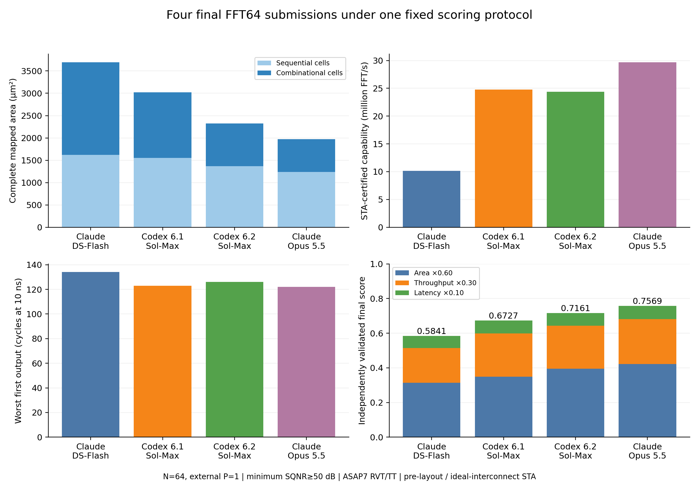
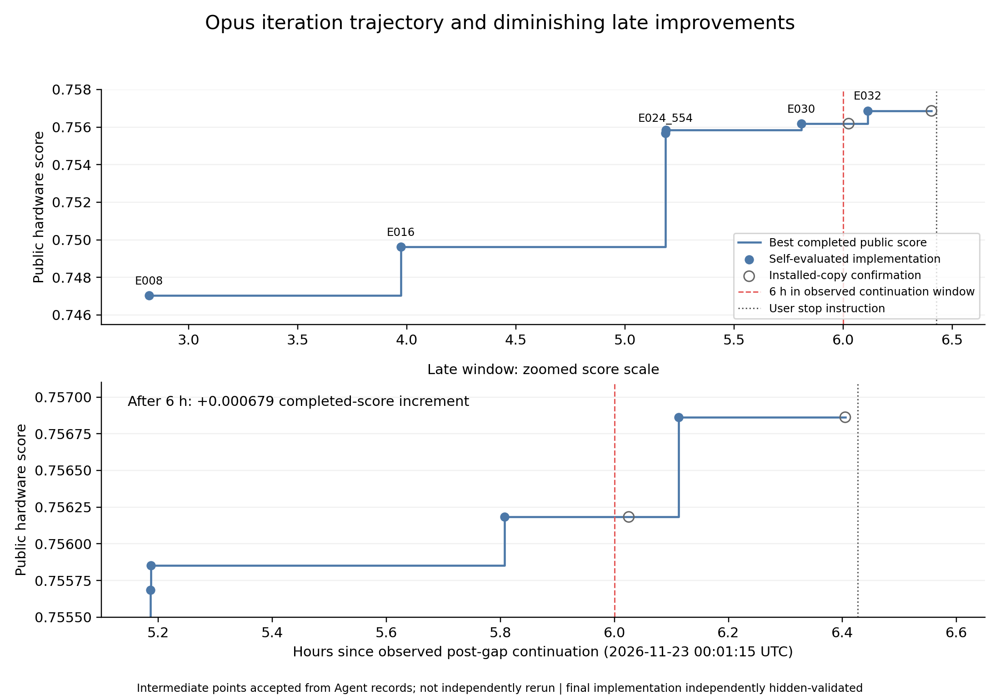

# 四次 FFT64 Agent 实验：结果与分析

四份最终提交均通过同一独立隐藏评测。Opus 本次交付电路的面积最小、认证周期最短、首输出最早，综合分为 **0.756863**。其运行时间由用户记录为 6h30m，明显长于另外三次，因此这里比较交付电路，不给出等时间预算下的模型能力排名。Fable 因网络问题未开展，排除于样本之外，不记零分。

## 最终结果

| 实验标签 | 完整面积 μm² | 认证周期 ns | 验证 II | 认证能力 M FFT/s | 首 / 末输出 cycles | 最低隐藏 SQNR dB | 综合分数 | 用户记录用时 |
|---|---:|---:|---:|---:|---:|---:|---:|---|
| Claude-DS-Flash | 3695.72 | 0.764160 | 129 | 10.144 | 134 / 197 | 66.1488 | **0.584148** | 1h55m16s |
| Codex-GPT-6.1-Sol-Max | 3023.22 | 0.630859 | 64 | 24.768 | 123 / 186 | 52.7570 | **0.672667** | 37m33s |
| Codex-GPT-6.2-Sol-Max | 2327.20 | 0.640381 | 64 | 24.400 | 126 / 189 | 59.4169 | **0.716134** | 37m15s |
| Claude-Opus-5.5 | 1970.57 | 0.526123 | 64 | 29.698 | 122 / 185 | 52.5581 | **0.756863** | 6h30m |

四个设计均为 N=64、外部输入/输出 P=1，使用同一 ASAP7 RVT/TT、VCS/DC/PrimeTime 流程。强制规格为 10 ns、最低逐非零帧 SQNR≥50 dB、II=384 连续服务及协议/延迟约束。所有最终候选各自接受 8192 个隐藏随机非零帧和 192 个定向帧，321 个整数 II（64–384）各测 1024 连续 RTL 帧；最小通过 II 再用代表性 mapped 子集确认，并检查三种门级初始状态。此前三个候选复用已完成的独立验证，Opus 最终提交新做完整验证，中间搜索不重复运行。

最高认证能力按 1e9/(STA 通过端点×实测 II) 计算。表中时序为同一固定导出网表的扫描端点；延迟分项使用共同 10 ns 时钟下的最大首输出 cycles，物理 ns 另存于 CSV。全部是布局前 cell area 与 ideal-interconnect STA；没有 post-route 或可靠功耗数据。门级仿真是代表性覆盖，质量是有限样本观测，均不等于完整形式化保证。

## 分数差异的来源

| 实验标签 | 面积加权贡献 | 吞吐加权贡献 | 延迟加权贡献 | 顺序单元 μm² | 组合单元 μm² | 顺序面积占比 |
|---|---:|---:|---:|---:|---:|---:|
| Claude-DS-Flash | 0.313633 | 0.200473 | 0.070042 | 1622.83 | 2072.90 | 43.91% |
| Codex-GPT-6.1-Sol-Max | 0.348651 | 0.249333 | 0.074684 | 1551.98 | 1471.24 | 51.34% |
| Codex-GPT-6.2-Sol-Max | 0.394203 | 0.248513 | 0.073418 | 1370.32 | 956.89 | 58.88% |
| Claude-Opus-5.5 | 0.422486 | 0.259271 | 0.075105 | 1236.25 | 734.32 | 62.74% |

Opus 相对 Codex 6.2：面积减少 **15.32%**，认证吞吐增加 **21.72%**，首输出提前 **4 cycles**，总分增加 **0.040728**。其中面积、吞吐、延迟分别贡献 +0.028283、+0.010758、+0.001688。顺序单元减少 134.06 μm²，组合单元减少 222.56 μm²，不能把全部差距归因于某一个位宽或存储技巧。

Opus 的最低 SQNR 余量为 2.56 dB，低于 DS-Flash 和 Codex 6.2；但四者均超过同一 50 dB 门槛，规则不奖励额外精度。Opus 在这次固定门槛的硬件比较中优于其余三份提交，这不是“不论精度都更好”，也不是跨模型总体能力的统计结论。

## 策略差异的详细分析

在本题冻结的 60% 面积、30% 吞吐、10% 延迟目标下，交付电路的次序明确为 Opus > Codex 6.2 > Codex 6.1 > DS-Flash。这个次序不等于所有策略或模型的全局优劣：不同运行同时改变了架构、精度、流水和映射，时长也不同。下面优先用同一运行内的对照说明策略效果，再解释最终电路的结构差异。

最终指标来自独立隐藏验证；中间对照来自 Agent 完整公开自测，开发阶段面积/延迟来自作者记录；跨 Agent 的机制解释是结构推断。`strategy_evidence.csv` 给出 21 组对照的完整差值和 RTL 哈希是否相同，避免把组合变化误写为单因素因果。

## 一、架构和状态调度：最先决定成本的部分

| 运行 | 最终结构与状态处理 | 有效之处 | 主要限制 |
|---|---|---|---|
| DS-Flash | R2SDF DIF，自由运行并依赖空闲周期刷新，64-word 输出重排 | 修复了反馈深度、样本/相位偏移及系数 mux 路径，数值和协议最终正确 | 当前控制需要 II=129；比较 II=64 时主要考虑昂贵双 buffer，没有实现后续其他运行给出的低成本调度方案 |
| Codex 6.1 | R2²SDF DIF，单个 64-word 重排存储交替读写排列 | 真正测量 folded 与 streaming，再用一个 buffer 支持 II=64 | 重排存储处于较宽的数据端，读选择与控制也有成本；在此布局上继续压频较昂贵 |
| Codex 6.2 | R2²SDF DIT，49-word 输入位交换，局部 valid 驱动计数 | 把重排放在窄输入侧，避免大地址式输出读 mux；II=64 不需要双帧 buffer | DIT 改变后级长延迟的数据位宽，并不是任何量化配置下都必然更省；需要共同映射检验 |
| Opus | R2³SDF DIF，49-word 流式输出位交换 | 一个通用 W64 + 两个常数 W8 旋转器，结合位宽和局部流水降低成本 | 当前胜出是整套组合；没有把所有 radix/DIT/DIF 在完全相同精度与 recipe 下穷举比较 |

**DS-Flash 的问题不在于 R2SDF 天生只能 II=129。** 它用刷新和当前输出调度保证正确性，随后把 II=64 的代价主要估为增加一个 64-word buffer。这个候选的成本估计可以是负收益，但不能据此否定所有低成本连续服务方案：Codex 6.1 的交替排列单 buffer、Codex 6.2 的输入位交换、Opus 的流式重排已经给出不同的可行选择。其最终 II 劣势更多来自实现/候选集合，而不是 FFT 规格要求。

Codex 6.1 的同次实验中，两 BU folded F003 的完整分数为 0.546016；初始 SDF S001 虽然面积更大，分数仍提高至 0.575940，因为 II 从 224 降到 64。这说明它正确地用整机目标淘汰了“算术更少所以必然更优”的假设。该 II=224 只属于那份 folded 实现，不能泛化为所有 folded FFT 下界。

Codex 6.2 的 DIF→DIT 对照把面积约 3061.23→2519.89 μm²、首输出 137→124 cycles，但认证周期变长；净分数仍从 0.587217→0.617622。结构变更有效的直接证据是这些完整自测指标，不是单纯“DIT”这个名字。

最终重排存储的静态容量如下。只计重排数据，不计反馈存储、流水、控制和读写选择；不能直接当作全部顺序单元面积。

| 运行 | 重排位置 | complex words | 每实/虚分量位宽 / 小数位 | 声明数据容量 bits |
|---|---|---:|---:|---:|
| DS-Flash | 输出 | 64 | 22 / 15 | 2816 |
| Codex 6.1 | 输出 | 64 | 19 / 12 | 2432 |
| Codex 6.2 | 输入 | 49 | 15 / 15 | 1470 |
| Opus | 输出 | 49 | 17 / 10 | 1666 |

这解释了重排组织和精度的成本差异，也显示不能只看这一项：Opus 重排容量略大于 Codex 6.2，但总顺序面积更小，反馈位宽、流水、控制及映射仍在起作用。细项见 structure_summary.csv。

## 二、精度与量化：重点是数值语义，而非只减总位数

DS-Flash 最终大体保持 Q15 小数位并逐级增加保护位，因此隐藏 SQNR 最高、硬件却较大。它做过一次窄化试验，但该失败需要修正解释：原文称“20-bit Q13 在 |X|=32 时溢出”；signed 20-bit Q13 实际可表示约 ±64，足够覆盖该值。保存的生成器在 RAMW=20 时只保留低 20 位，读取后只符号扩展，没有做 Q15→Q13 右移/舍入和输出尺度恢复；实际仍是 Q15，范围仅约 ±16，FFT DC=32 会超范围。可见试验命令确实以 RAMW=20 调用了该生成器。此结论来自静态源码检查与已记录失败现象的一致性，未重新仿真失败版本。

因此，**这次失败应归为窄化时数值对齐的实现问题，不能当作“合理 precision scaling 没有空间”的证据**。最终恢复 22-bit 的候选已通过验证，不影响其最终成绩。对应静态检查与来源哈希见 precision_trial_static_check.json，审核包不包含生成器代码。

Codex 6.1 正确地同时调整分数位、舍入和接口恢复：输入 Q15→Q14，stage 2/4 后再到 Q13/Q12，nearest-even 边界增加数值余量。它没有盲目接受更窄 buffer：最终重排再降至 Q10/Q11 的完整映射面积反而增加约 77.94/146.85 μm²，周期也变差，分数下降 0.005274/0.009118，因此保留较宽的 Q12 buffer。这里是有效的负结果，而非未完成数值格式转换的失败。

Codex 6.2 把“总位宽”和“分数位精度”分开：给定输入幅度允许用 signed 15-bit Q15 保留 15 个小数位，仅在 +0.5 端点饱和一 LSB；这与 Codex 6.1 的 signed 15-bit Q14 不同。重新安排 Q15→Q14→Q12 的量化位置与 Q9/Q10 系数后，某次更窄实现的数值质量反而比前一个“高精度”配置好，说明误差敏感度与量化位置很重要。该步骤包含多个相关改变，不能把全部差值只归因于少一位。

Opus 进一步用范围分析限制保护位、按算子/阶段选择截断或舍入，并把输出量化得更粗，最终隐藏余量约 2.56 dB。它更充分地使用了允许的误差预算，但并不是“越贴近 50 dB 越好”：它拒绝了 Q8 twiddle 变体，因为面积反而多约 39 μm²、数值余量更少。质量和面积必须一起实测。

## 三、旋转器与流水：操作数量不等于 mapped 成本

Codex 6.1/6.2 都用三实乘法复乘，Opus 最终 W64 却使用四实乘法。这并不矛盾：三实乘法会增加前加法、某些系数和中间量宽度，关键路径也可能更长。Codex 6.1 的 folded 开发对照曾出现三实乘法面积更小但周期更差；Opus 的同配置开发试验中，Gauss 形式多约 19 μm²，因此拒绝。不能仅凭乘法器数量给实现排序。

Codex 6.1 注册系数和三个乘积后，C003→C004 的面积增加、首输出晚两周期，但认证周期明显缩短，净分数增加 0.008625。这是有效的流水投入。它最终较大的面积一部分与该布局和较强时序目标下的实现成本相伴，不能单独归罪于任意一个寄存器。

Codex 6.2 的 split-product 流水把周期 0.754639→0.621338 ns，却使面积约 2319.77→2513.08 μm²，首输出晚两周期，净分数下降 0.004047；另一次更强 retiming 也更快但总分下降。它选择较慢、较小的版本符合共同目标。最后移除两个输入位交换的输出寄存器，在周期和 SQNR 不变时省约 17.47 μm²、提前两周期，是较清楚的局部成功对照。

Opus 将 W8 的 pre-add/select 与常数乘法手动分开，W64 保留适当流水并局部 retiming。它也试过删除 stage-3 寄存器，但组合路径过长，故未采用。它的优势是针对具体组合依赖分配流水，而不是追求最少或最多寄存器。

## 四、技术库与综合策略：Opus 额外探索了什么

Opus 利用 ASAP7 某些顺序单元只有反相输出的特征，交替编码 delay storage 极性，从而减少显式反相器。其早期相同开发条件下约省 153.47 μm²。**这是精确的技术映射/表示优化，不是近似误差带来的收益**；该数值也不能直接与最终 526 ps 结果相加，因为后续精度、流水和综合条件变过。

四者都做了时钟目标 steering。Codex 6.1 选择 500 ps，Codex 6.2 选择约 640 ps 并做面积恢复；Opus 在逐步改良流水后再把目标压到 526 ps。源文档还记录某些 timing-high-effort 参数被旧版 DC 忽略，因此不能看到 recipe 里写了某个 flag 就声称它产生了效果，实际导出网表和独立 STA 才是证据。

Opus 后期同一 RTL 的 ungroup+额外恢复把面积 1970.89524→1967.01696 μm²，周期与延迟不变；继续调至 526 ps 又略增面积但总分更高。其 recipe 搜索范围比本批其他运行更细，代价是更长时间，而且最后一轮只有约 0.32 μm² 的额外开发收益。

## 五、搜索过程各自好在哪里、欠缺在哪里

| 运行 | 本次探索的优点 | 本次探索的欠缺 | 对本题结果的解释 |
|---|---|---|---|
| DS-Flash | 正确修复协议/相位，改善系数选择关键路径，按综合目标选择 700 ps 而非更激进目标 | 主要停留在 R2SDF 与时钟 sweep；R2² 未实现；缩位实验的数值语义有问题；II=64 方案集合偏窄 | 正确且高精度，但没有有效释放精度和状态组织的成本空间 |
| Codex 6.1 | 实际比较 folded/SDF，阶段精度、舍入、复乘和流水均有记录；完整评测拒绝了不划算的更窄 buffer | 最终仍是较宽的输出地址式重排与偏强时序目标；没有覆盖输入位交换和库极性编码等方向 | 较强的数值/时序实现，面积使其输给另外两份高性能 SDF |
| Codex 6.2 | 快速检验结构替换，区分整数冗余与小数精度，能拒绝“更快但总分更低”的方案 | 没有探索到本次 Opus 的 R2³/W8 组织与极性编码；保留较多数值余量 | 在其约 37 分钟记录内获得很强的面积/精度折中；不能据此声称等预算模型效率最优 |
| Opus | 组合探索架构、范围、算术、存储编码、流水、映射，保留负结果并最终确认导出 | 时间约为 Codex 6.2 的 10.47 倍；后期在同一 RTL 的小范围精修收益很小；部分解析最优性声称未形式化证明 | 本轮交付硬件最好，但其获胜不能被解释为排除了时间和探索预算差异后的纯模型优势 |

最终 Opus 相对 Codex 6.2 的面积差 356.63 μm² 中，顺序单元约 134.06、组合单元约 222.56。评分增加 0.040728 中，面积约贡献 0.028283，吞吐约 0.010758，延迟约 0.001688。这准确解释了“分数差在哪里”；至于这些面积差分别有多少由 radix、位宽、极性或 recipe 导致，需要共同父设计的受控实验才能精确拆分，本轮没有把不同条件下的局部收益硬相加。

## 六、可迁移的策略结论

1. 先正确处理增益、数值格式、状态有效性和重排，再谈“位数更少”或“II 更小”；数值语义错误的失败不能代替近似策略评估。
2. 对本题而言，结构和存储调度值得优先探索，随后按实际输出误差分配精度，而非从一种初始布局无限微调。
3. 算子数量、寄存器数量、局部频率均不能代替完整 mapped area/II/latency 的共同评分；同次对照已给出多个反例。
4. 技术库感知的精确优化同样重要。应将其与近似量化的收益区分，而不是把所有节省都称为近似计算贡献。
5. 当已测局部变体的增量降到几平方微米甚至 0.32 μm² 时，停止当前局部搜索有依据；仍不能断言另一个架构或表示不存在更大收益。

## Opus 的迭代与后期收益

保留了 **37 行作者实验记录、126 份开发测量摘要、8 次完整公开 architecture 评测（6 个不同映射实现）**。所有中间点按用户要求采信 Agent 的自测记录，未独立重跑；开发阶段的面积/延迟估计和 quick 数值检查不当成完整资格分数。

详见 [OPUS_ITERATIONS.md](OPUS_ITERATIONS.md) 和 opus_public_iterations.csv。较早的高价值步骤包括交替极性存储、范围感知位宽、W8 两级流水、控制器注册。后期主要在同一 RTL 上调整综合目标和面积恢复参数，额外自由度的收益逐渐变小。更窄系数反而面积变大、删除寄存器导致时序恶化等负结果也保留。

以跨夜大间隔后的观察窗口为时间轴，6 h 前的最高完整公开分数为 **0.756183**；最终为 **0.756863**，增加 **0.000679**。这一步面积反而增加 3.55752 μm²，通过认证周期缩短 9.521 ps 换取小幅分数提高。之后的最后一轮开发试验仅再减少 0.32076 μm²；若其他指标完全不变，理论评分增量约 0.00002727。该点未做完整重新资格评测，未替换最终提交。

因此，“当前局部搜索后期收益已小，停止有实际依据”得到记录支持；“已经全局收敛，继续搜索必无收益”不受这些实验支持。

## 时间、人工干预与可比性

四者初始任务在去除粘贴格式后相同。时长按用户给出的 1h55m16s、37m33s、37m15s、6h30m 保存，不计入硬件分数。Opus 原始消息跨度约 15.28 h，其中最长事件间隔约 7.53 h；之后的观察窗口为 6.56 h。不能把整个原始跨度当作有效计算时间，也不把删除长间隔后的窗口称作精确 CPU/模型活跃时间。人工收尾指令在日志中保留。

Opus 的用户记录时长约为 Codex 6.2 的 10.47 倍。每个模型只有一次运行，时长、停止方式和外部服务等待不相同；当前数据足以比较这四份具体电路和观察搜索过程，不足以给出等预算模型效率、统计显著性或模型总体能力排名。

## 可支持的结论

1. 四个最终候选均通过共同隐藏协议；Opus 本次交付的硬件综合分最高，面积、认证吞吐和首输出延迟均优于另外三份。
2. 共同 SQNR 门槛下，较高精度并不会自动得到更高硬件分；允许误差预算与范围约束的使用方式确实影响实现成本。
3. 流水、精度和综合参数需要一起评价。减少位宽、减少寄存器或减少乘法数量，都不保证完整映射面积或综合分单调变好。
4. Opus 后期主要是在既有架构附近做精修，已经完整评测的增量小；最后未提交的开发点也只有约 0.32 μm² 收益，支持本次停止决定。
5. 这些结论限定于四次单次实验和当前 pre-layout 流程，不等于模型总体排名、全局最优、功耗收益或 post-route 改善。

作者原始探索文字/表格见 exploration_records/；统一流程摘要见 [EXPLORATION_SUMMARY.md](EXPLORATION_SUMMARY.md)。[DOCUMENT_NOTES.md](DOCUMENT_NOTES.md) 列出原始记录中应修正或限定的表述。
