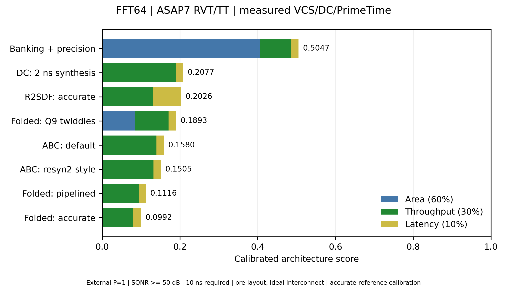
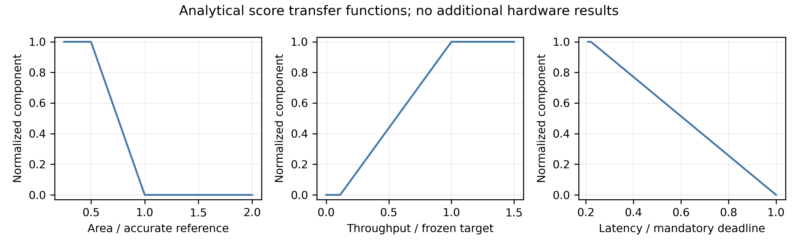

# FFT64 评分区分度实测

8 个满足基本规格的实现得到了 8 个不同的有效分数，范围为 **0.0992–0.5047**。架构、系数精度、存储组织、流水和综合 recipe 的变化都能反映到实际硬件测量与评分中。过度量化的反例未达到 50 dB SQNR，正确得到有效零分。

同时发现一个重要限制：**8 个可行实现中，6 个的面积分项为零。** 当前归一化把大于等于准确参考面积的所有实现放在同一个面积零分区间；这些实现之间的排名由吞吐率和延迟决定。因此，本次实验证明了总分有区分度，但不能证明面积分项在整个设计空间都有区分度。实验期间没有调整评分函数、权重或目标比例。

## 测量条件

所有实现都是 64 点复数 FFT，外部输入/输出并行度均为 1。输入为每分量 16 位、15 位小数的有符号数，每分量范围为 [-0.5, 0.5]；非零帧复数 RMS 至少为 1/32。输出按相同的 15 位小数解释，数学参考为同一量化输入的 double-precision、未归一化 forward FFT，输出为自然频率顺序。

统一采用 ASAP7 RVT/TT，VCS 仿真和 DC/PrimeTime 独立面积、时序测量。ABC 两个候选由宿主机 Yosys/ABC 产生网表，再导入相同商业评测流程；没有混用开源后端的评分标尺。结果是 **pre-layout cell area / ideal-interconnect STA**，没有完成布局布线、功耗或硅片验证。

验证覆盖如下：

- 每个实现使用同一套 **8,192 个独立随机非零帧 + 192 个 directed cases**。FFT 长度始终是 64；每个实现共 536,576 个复数数值样本。
- 连续 384-cycle 服务、复位、输出顺序和延迟检查；最差非零逐帧 SQNR 至少 50 dB，零帧必须精确输出零。
- 对每个不同 RTL，穷举 **II=64…384 的全部 321 个整数值**，每个 II 使用 1,024 个连续帧。相同 RTL 的 DC/ABC 网表共享身份一致的 RTL 容量结果，5 个不同 RTL 实际执行了 5 套完整扫描。
- 8 个可行网表分别进行代表性 RTL/mapped 行为检查，包括三种寄存器初始状态，以及被选中 II 下的 mapped 子集检查。没有把全部 321 个 II 都称为完整门级扫描。
- 每个固定网表独立进行 STA clock scan，使用通过端点认证周期，失败/通过区间宽度不超过 0.01 ns；不把一次 10 ns 约束下的 slack 或自报频率当作 Fmax。

准确 folded、准确 block-scheduled R2SDF、增加流水的 folded、DC 收紧约束以及两个 ABC 候选，在上述 536,576 个数值输出样本上与准确 folded **逐样本完全一致**。这是有限样本的结果，不是 formal equivalence 或 worst-case error guarantee。这里的 R2SDF 是带块调度和输出重排的具体实现，不能代表最优的完全流式 SDF。

## 实际电路与总分

下表的周期来自固定网表 STA 扫描；II 来自连续帧实测。首输出延迟是适用测试中的最大逐帧延迟。所有 8 个可行点均为 `resolved=true, score_valid=true`，分数低于 0.8 不影响通过。

| 实现 | 面积 μm² | 认证周期 ns | Fmax MHz | 最小验证 II | 首输出 cycles | 最低 SQNR dB | 总分 |
|---|---:|---:|---:|---:|---:|---:|---:|
| 准确 folded，默认 DC | 2437.28 | 3.8396 | 260.44 | 320 | 256 | 70.39 | **0.0992** |
| 准确 block-scheduled R2SDF | 3644.52 | 4.3633 | 229.19 | 197 | 133 | 70.39 | **0.2026** |
| Folded，twiddle 小数位 16→9 | 2264.86 | 3.6777 | 271.91 | 320 | 256 | 62.36 | **0.1893** |
| Folded，parity banking + 精度缩减 | 1614.78 | 3.8206 | 261.74 | 320 | 256 | 55.11 | **0.5047** |
| 准确 folded，butterfly 增加流水 | 2631.19 | 3.3445 | 299.00 | 326 | 262 | 70.39 | **0.1116** |
| 准确 folded，DC timing effort + 2 ns 综合目标 | 2601.54 | 2.0020 | 499.51 | 320 | 256 | 70.39 | **0.2077** |
| 准确 folded，默认 ABC mapping | 3531.36 | 2.5637 | 390.06 | 320 | 256 | 70.39 | **0.1580** |
| 准确 folded，resyn2-style ABC mapping | 3709.28 | 2.6780 | 373.42 | 320 | 256 | 70.39 | **0.1505** |
| 过度量化反例，input drop=6 / twiddle fraction=5 | 未测 | 未测 | 未测 | 未测 | 未纳入性能评分 | **27.92** | **0，有效不通过** |

反例在数值阶段即失败，因而没有继续消耗完整 ASIC 测量资源。这里的“未测”不能解释为零面积或零吞吐率。

| 实现 | 有效吞吐率 M FFT/s | 10 ns 下首输出 ns | 认证周期下首输出 ns | 整帧完成 cycles |
|---|---:|---:|---:|---:|
| 准确 folded | 0.813887 | 2560 | 982.94 | 319 |
| 准确 block-scheduled R2SDF | 1.163377 | 1330 | 580.32 | 196 |
| Twiddle 小数位 9 | 0.849708 | 2560 | 941.50 | 319 |
| Banking + 精度缩减 | 0.817944 | 2560 | 978.06 | 319 |
| Butterfly 增加流水 | 0.917178 | 2620 | 876.25 | 325 |
| DC 2 ns 综合目标 | 1.560976 | 2560 | 512.50 | 319 |
| 默认 ABC | 1.218932 | 2560 | 656.31 | 319 |
| Resyn2-style ABC | 1.166925 | 2560 | 685.56 | 319 |

吞吐率为 `1e9/(认证周期 ns × 验证 II)`。延迟评分使用共同 10 ns 时钟下的 ns 值，避免再次奖励频率；另列认证周期下的物理延迟供解释。认证频率是当前 STA 模型下的能力估计，不是 post-route 频率。

## 不同操作为什么改变分数

**系数精度。** 仅将 folded 的 twiddle 小数位从 16 减到 9，数据通路宽度保持 22 位。系数总有符号位宽为 11 位，不能称作整个系数只有 9 位。面积下降 7.07%，有效吞吐率增加 4.40%，最低 SQNR 从 70.39 降到 62.36 dB，仍满足 50 dB。分数从 0.0992 增加到 0.1893，体现了使用误差预算降低硬件成本的收益。

**存储组织与精度组合。** Parity banking、输入 RNE 丢弃 1 位、内部数据宽度 22→21 位和 twiddle fraction=9 组合后，面积下降 33.75%，最低 SQNR 为 55.11 dB，分数达到 0.5047。该点证明组合优化可以获得明显差异，但本轮没有单独隔离 banking 的贡献，不能把全部下降归因于存储组织。

**架构选择。** Block-scheduled R2SDF 的面积增加 49.53%，时钟也较慢，但验证 II 从 320 降到 197，首输出从 256 降到 133 cycles。有效吞吐率增加 42.94%，总分增加到 0.2026。这说明架构选择会通过实际服务能力影响评分，也暴露了面积零分区间的问题。

**流水优化。** 增加 butterfly 流水后，面积增加 7.96%，II 从 320 增到 326，首输出延迟从 256 增到 262 cycles；认证时钟更快，使有效吞吐率增加 12.69%，总分小幅增加到 0.1116。减少组合路径和提高吞吐率不是同一件事，评分使用两者的实际组合。

**DC recipe。** 对完全相同 RTL 使用 timing-high-effort 和 2 ns 综合目标，面积增加 6.74%，认证周期从 3.8396 降到 2.0020 ns，有效吞吐率增加 91.79%，分数增加到 0.2077。ASAP7 原始时间单位为 ps，recipe 中的 `create_clock -period 2000` 对应 2 ns。最终评测仍使用统一规格重新导入网表并做 STA，分数来自实测结果。

**ABC recipe。** 在同一准确 RTL 上，展开的 `balance/rewrite/refactor/rewrite -z/refactor -z` resyn2-style 序列再做 mapping，相比默认 ABC 面积增加 **5.04%**、周期增加 **4.46%**，总分从 **0.1580 降到 0.1505**。它是保留的负结果：调用更多优化命令不保证更好的映射，也不会因为命令名而加分。

这些对照足以证明 benchmark 能响应多种真实设计变化，但没有覆盖所有 DC/ABC 参数，更没有证明任意两个选项都必须产生不同分数。

## 分数来源与区分度

沿用冻结规则：

\[
S=V(0.6S_A+0.3S_T+0.1S_L).
\]

校准只使用上表中两个通过完整验证的准确参考实现：

| 分项 | 零分参考 | 满分目标 |
|---|---:|---:|
| 面积 | 2437.28028 μm² | 1218.64014 μm² |
| 吞吐率 | 260416.6667 FFT/s，即 384 cycles × 10 ns 服务 | 2326754.4956 FFT/s，即准确参考最佳吞吐率的 2 倍 |
| 首输出延迟 | 3000 ns，即 300 cycles × 10 ns | 665 ns |

以上是 componentwise anchors，不代表存在一个同时达到所有参考值或目标值的物理设计。候选没有参与目标比例或权重的调节。

| 实现 | 面积贡献 0.6S_A | 吞吐贡献 0.3S_T | 延迟贡献 0.1S_L | 总分 |
|---|---:|---:|---:|---:|
| 准确 folded | 0 | 0.08036 | 0.01884 | 0.09920 |
| 准确 block-scheduled R2SDF | 0 | 0.13110 | 0.07152 | 0.20262 |
| Twiddle 小数位 9 | 0.08489 | 0.08556 | 0.01884 | 0.18929 |
| Banking + 精度缩减 | 0.40496 | 0.08094 | 0.01884 | 0.50475 |
| Butterfly 增加流水 | 0 | 0.09535 | 0.01627 | 0.11163 |
| DC 2 ns 综合目标 | 0 | 0.18882 | 0.01884 | 0.20766 |
| 默认 ABC | 0 | 0.13916 | 0.01884 | 0.15801 |
| Resyn2-style ABC | 0 | 0.13161 | 0.01884 | 0.15045 |

8 个可行点的分数跨度为 **0.40555**，总体标准差为 **0.11999**，保留 6 位小数仍有 8 个不同分数。最接近的一对为 DC 2 ns 和 R2SDF，差 **0.00505**。当前 clock scan 网格产生的单点分数区间上界宽度为 0.00029–0.00108，小于该差值；这只检查 STA 网格分辨率，尚未量化不同综合随机性、机器或工具版本的重复实验方差。不能据此宣称极小分差都可靠。

### 面积分项的零分区间

当前面积项为：

\[
S_A=\mathrm{clip}\left(\frac{A_{ref}-A}{A_{ref}-A_{target}},0,1\right).
\]

当 `A≥2437.28028 μm²` 时，`S_A=0`。因此面积从 3709 减到 3531 μm²，甚至进一步减到 2602 μm²，这一项始终不给反馈。声明的“面积权重 60%”不等于在所有面积区间都有 60% 的有效区分作用。

这是当前归一化的数学性质，不是面积漏计、错误分母或缓存复用导致。只要要求分项非负、参考准确设计的面积分恰为零，并且面积越大分数越低，就不可能再严格区分参考面积以上的点。

若未来希望这一区间也有区分度，需要在下一轮正式评测前共同冻结另一种标尺，例如让参考设计取得非零面积分，再为更大面积保留下降区间；同时保留当前一轮结果的规则。只调整 60/30/10 权重不能消除面积项本身的平坦区。本轮没有用候选反向选择新函数，也没有把假设的新分数混入正式排名。

## 应该不改变分数的操作

另有 **11 项 scorer replay 检查全部通过**，与真实 ASIC 对照分开保存于 [scorer_controls.csv](analysis/scorer_controls.csv)：

- 把 Agent 自报 II 改为 64、128、320 或 384，结果相同；评分读取验证 II。
- 在已可行的结果中将 SQNR 字段改为 50、60 或 100 dB，没有附加奖励。
- 修改 informational frequency 或 producer-reported area，没有替换实际网表测量和认证。
- 错误的 calibration 身份和模拟的 infrastructure 状态都产生 `score_valid=false`，应排除排名。

这些是评分器输入回放，不是新一次工具运行，也不是实际注入许可证故障。真实失败对照是上表 27.92 dB 的过度量化 RTL。

需要特别区分三种结果：

| 情况 | resolved | score_valid | 排名解释 |
|---|---|---|---|
| 满足规格、硬件分数低 | true | true | 正常参与排名，不设 0.8 门槛 |
| 观察到 SQNR/协议/时序等基本规格失败 | false | true | 有效零分 |
| 工具故障、证据不完整、缺少匹配 calibration | 不应当作有效通过 | false | 不参与硬件分数比较 |

原始 `measurement/result.json` 保留了测量时尚未装入校准的 grade，可能显示数值 0 且 `score_valid=false`。**该值不是本轮最终分数。** 最终有效 grade 位于 `analysis/*_grade.json`，统一表为 [measured_scores.csv](analysis/measured_scores.csv)。所有 9 个最终结果都已用同一有效 calibration 重算。

还保存了 `area` profile 的派生诊断值。它回答纯面积问题，与 `architecture` 使用不同目标，不能将两种 profile 的分数混排；准确或较大面积实现得到零面积分，也不代表基本功能失败。

## 资源与文件清理

主要 7 项队列以最多 6 个 worker 完成，耗时约 34.3 分钟；两个 ABC 候选独立构建并完成同样评测。相同 RTL 的容量缓存受原有身份检查和锁保护，mapped qualification 与频率认证仍按网表独立进行。监测记录只覆盖主队列部分时间窗口及其后代，不能用其中的 RSS 数值宣称整个任务的完整峰值。

本次共释放 **70,502,297,600 allocated bytes，约 65.66 GiB**，清理 3,554 项操作，未出现清理错误：

- 删除旧 Verilator/仿真器可重建生成物，包括生成 C++、目标文件、静态库和二进制；保留手写源码及构建元数据。
- 253 份大型 Yosys JSON 改为相邻的 `.json.gz`；逐文件解压后 SHA-256 相符才移除原 JSON。
- 保留 RTL、最终 mapped Verilog、ALS 结果、数值数据集、指标、日志和报告；未停止或清理仍在运行的其他 ALS 任务。
- 两组研究目录的 `.v/.bin/.npy` 总字节数在清理前后保持一致。这是范围保留检查，不等价于对所有历史文件做逐个哈希审计。

清理路径和回执位于 `cleanup/`；恢复某份 JSON 可使用 `gzip -dk /absolute/path/to/mapped.json.gz`。本轮原始逐周期文本仍保存在本机实验目录，私有分支保留约 106 MiB 的紧凑证据，包括实际输入/输出、每帧指标、完整 II 扫描摘要、网表和工具报告。

## 可以得出的结论

当前 benchmark 能识别架构、精度、流水、DC 和 ABC recipe 对实际硬件的影响，且能保留优化变差的负结果；基本可行性与连续硬件分数正确分离。本轮样本对总分具有明确区分度，但 **参考面积以上的面积零分区间会削弱综合排名的面积导向性**，正式扩大 Agent 对比前应明确是否接受这一性质。

本轮没有证明某种架构或 recipe 普遍最优，没有证明所有操作必须对应不同分数，也没有为 mixed precision 或 ALS 建立新的 SOTA 结论。此处的实验目标是验证评分机制与设计选择之间的实际联系。
